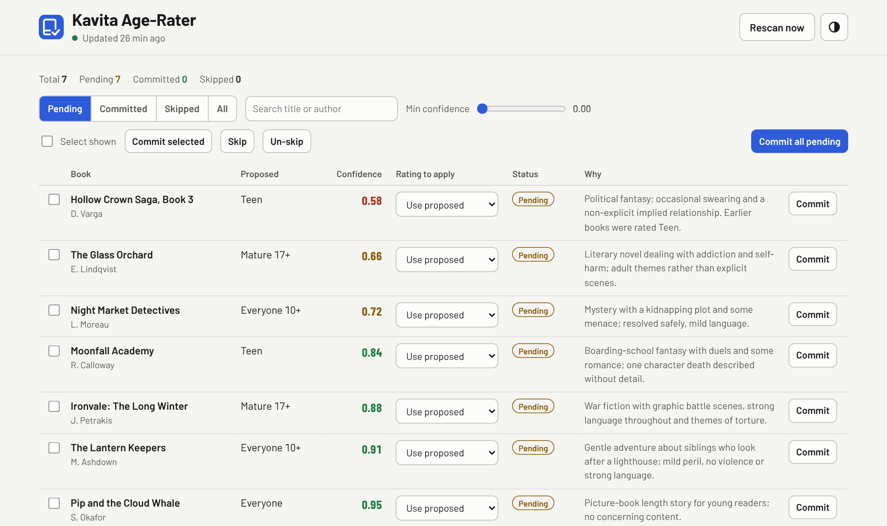
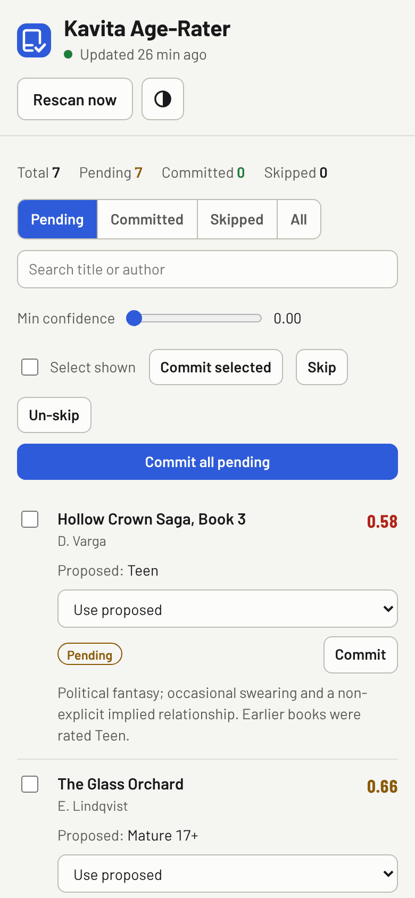

# Kavita Age-Rater

<picture>
  <source media="(prefers-color-scheme: dark)" srcset="docs/screenshots/desktop-dark.png">
  
</picture>

Assigns age ratings to the books in a [Kavita](https://www.kavitareader.com/)
library using Claude, so that restricted kids' accounts — and the
[Readest](https://readest.com/) apps that connect to them over OPDS — only ever
see age-appropriate books.

It runs as a **long-running Docker container** with a **web UI**: a background
scheduler classifies unrated books with Claude, and you review, override, and
commit the ratings from your browser.

## What it does

Open `http://your-server:5058`. You get a
table of books with their proposed rating, confidence (colour-coded, lowest
first), and reason. From there you can:

- Filter by **Pending / Committed / Skipped / All**, search by title/author, and
  hide low-confidence rows with the **min-confidence** slider.
- Change the **Rating to apply** dropdown on any row (an override).
- **Commit** a single row, a multi-select, or **all pending** at once. You confirm
  on the page first; each commit writes the rating to Kavita, locked.
- **Skip** books to leave them unrated.
- **Rescan now** to classify newly added / changed books immediately.

## On a phone

<picture>
  <source media="(prefers-color-scheme: dark)" srcset="docs/screenshots/phone-dark.png">
  
</picture>

The screenshots show invented books, not a real library. They follow your GitHub theme, light or dark, like the app itself.

## Why

Kavita doesn't read an age rating out of EPUB files, so ratings have to be set
through Kavita's API. This tool:

1. Periodically lists every **series** in Kavita with no age rating.
2. Sends each book's title / author / summary / genres to Claude, which picks
   the best rating from Kavita's own scale (Everyone, Everyone 10+, Teen, …),
   storing the result (with a confidence and a one-line reason) in a local DB.
3. Lets you **review** those proposals in a web UI — override any of them, then
   commit individually or in bulk.
4. On commit, writes the rating back to Kavita and **locks** the field so a
   library re-scan never wipes it.

Classifications are cached, so scheduled runs only classify **new or changed**
books. Anything Claude is unsure about is left **Rating Pending** (hidden from
restricted accounts) until you confirm it.

It follows my shared app standard (shared look, GitHub Actions → ghcr.io → Docker; see
[How this was built](#how-this-was-built)).

## Set up (Docker)

You need Docker and a login to GitHub's container registry while the image is
private (`docker login ghcr.io` with a `read:packages` token).

1. **Create folders and config.**
   ```bash
   sudo mkdir -p /srv/kavita-age-rater /opt/appdata/kavita-age-rater
   sudo chown -R 1003:1006 /opt/appdata/kavita-age-rater   # PUID:PGID from .env
   cd /srv/kavita-age-rater
   # copy docker-compose.yml and .env.example from this repo, then:
   sudo install -m 600 /dev/null .env      # fill it in from .env.example
   ```
2. **Start it.**
   ```bash
   sudo docker compose pull && sudo docker compose up -d
   sudo docker compose logs -f            # watch the first scan
   ```

### Updating

```bash
cd /srv/kavita-age-rater && sudo docker compose pull && sudo docker compose up -d
```
The database lives in `/opt/appdata/kavita-age-rater`, so updates and restarts keep
every classification, override and commit.

### Access

Port **5058** on the LAN, and over Tailscale. The app has no login, so don't expose it
to the internet.

## Configuration

Settings are environment variables in `.env` (see [.env.example](.env.example)):

| Variable | Default | |
|---|---|---|
| `KAVITA_URL` | | e.g. `http://your-server:5053` |
| `KAVITA_API_KEY` | | The token from your Kavita OPDS URL (Settings → Account) |
| `ANTHROPIC_API_KEY` | | From [console.anthropic.com](https://console.anthropic.com) |
| `AGE_RATER_MODEL` | built-in default | Override the Claude model |
| `AUTO_SCAN` | `true` | Classify unrated books automatically |
| `INTERVAL_HOURS` | `24` | Hours between automatic scans |
| `PUID`, `PGID` | `1003`, `1006` | User and group the container runs as (same as my other containers). `/opt/appdata/kavita-age-rater` must belong to them |
| `TZ` | `Europe/London` | |

### Kids' accounts (the enforcement side)

Ratings only restrict kids if their Kavita account enforces them:

- Give each child a Kavita account with an **Age Restriction** (e.g. *Teen*) and
  turn **"Include unknowns" OFF**, so unrated books are hidden.
- In Readest, connect that child's account via its **OPDS URL** — Readest then
  only ever sees the books Kavita allows for that account.

## Monitoring

- `GET /healthz` returns 200 while the database answers and scans aren't overdue (more
  than twice `INTERVAL_HOURS` plus an hour since the last good scan), otherwise 503. The
  Docker healthcheck uses it, so `docker compose ps` shows `healthy` or `unhealthy`.
- `GET /metrics` (Prometheus format, scraped by VictoriaMetrics): `age_rater_build_info`,
  `age_rater_last_scan_timestamp_seconds` (alert when it's old), `age_rater_last_scan_ok`,
  `age_rater_scan_running` and `age_rater_books{status=...}`. It makes no calls to Kavita
  or Claude, so scrapes are cheap.

## Development

```bash
python -m venv .venv && . .venv/bin/activate
pip install -r requirements-dev.txt
python -m pytest
python app.py          # needs KAVITA_URL, KAVITA_API_KEY and ANTHROPIC_API_KEY in .env
```

The logo is `static/icon.svg`; it's also the favicon. After changing it, regenerate the
icon set: `pip install cairosvg pillow && python scripts/make_icons.py --name "Kavita Age-Rater" --short "Age-Rater" --accent "#2e5bd9"`.

Pushing to `main` runs the tests and publishes `:latest` to ghcr.io.

## Files

```
docs/screenshots/             the pictures in this README (light and dark, desktop and phone)
.github/workflows/build.yml   tests, then builds the image to ghcr.io
Dockerfile, docker-compose.yml
app.py           Flask web app, /healthz, /metrics and the background scheduler
age_rater.py     Kavita API client, Claude classifier, scan/commit logic
db.py            SQLite store
templates/       index.html, the review page
static/          gomez-ui.css and gomez-ui.js (shared look, copied unchanged), app.css,
                 app.js, fonts, icon.svg and the generated icons
scripts/         make_icons.py
tests/           pytest smoke tests
```

## How this was built

This is one of several self-hosted apps I run at home. The code was written by Claude (an AI coding agent) under my direction. My part was the requirements, the standards, the review and the decisions:

- **Requirements first.** Functional and non-functional requirements were agreed as tickets in Obsidian before any code was written.
- **One shared standard.** All my apps share one look, one repo layout and one build-and-deploy pipeline (GitHub Actions → GitHub Container Registry → Docker Compose). `gomez-ui.css` and `gomez-ui.js` are the shared UI kit from that standard; gomez is my home server's name.
- **Reviewed before merging.** Every change came in as a pull request, with screenshots at desktop and phone widths in light and dark mode, and was merged only after I'd reviewed it and the tests passed.

More on how I work this way: [my GitHub profile](https://github.com/nick-a-louse).

## Licence

[MIT](LICENSE). Fonts are Barlow and Barlow Condensed under the SIL Open Font License (see the `OFL.txt` next to them).
